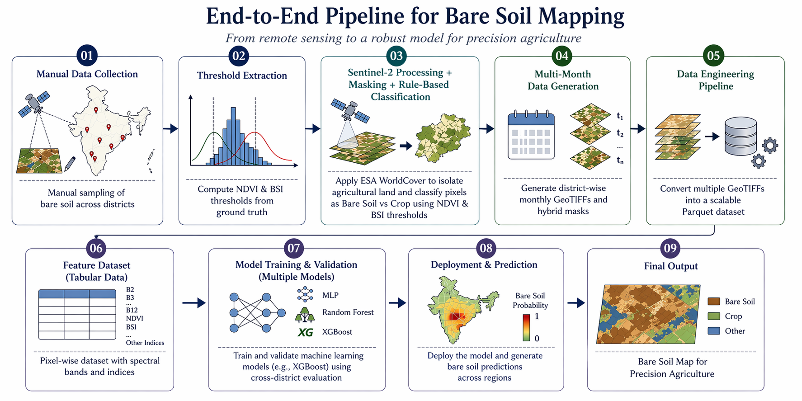
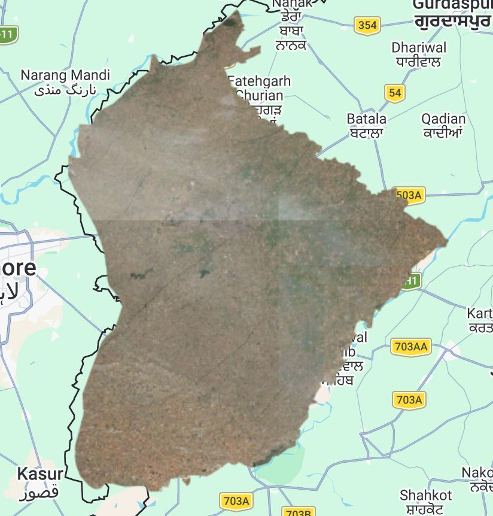
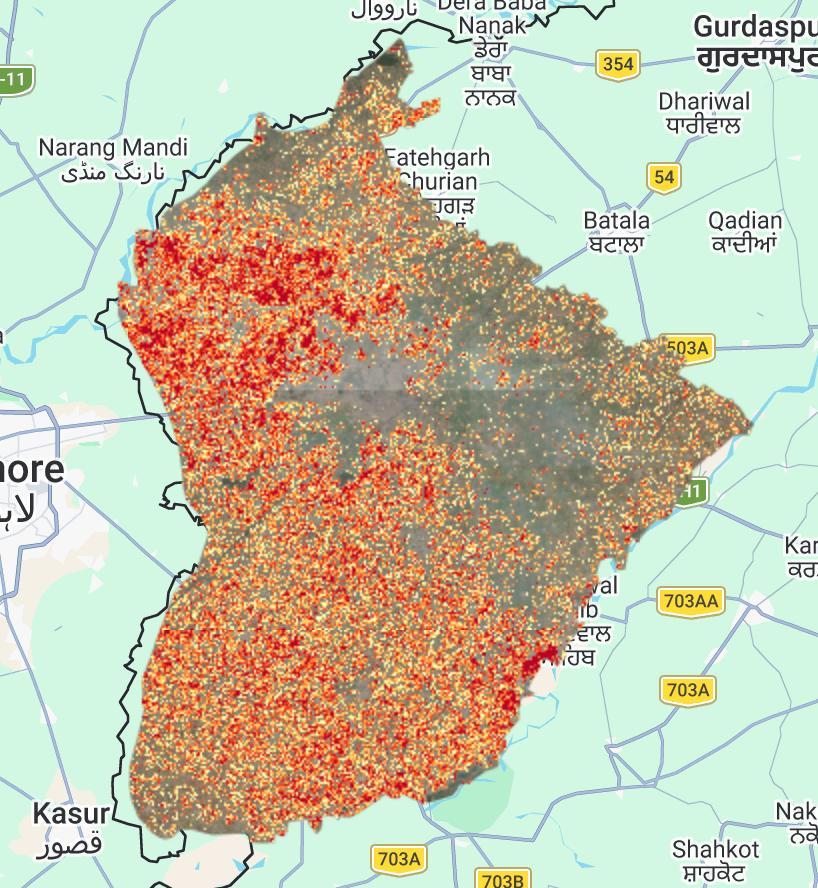

# Bare Soil Mapping for Precision Agriculture

**Team 18** · Mentor: Prof. Shashank Tamaskar

**Team:**
| Name | UID | Email |
|---|---|---|
| Aarav Luthra | U20230092 | aarav.luthra.ug23@plaksha.edu.in |
| Harkirat Singh | U20230082 | harkirat.singh.ug23@plaksha.edu.in |
| Saksham Bali | U20230061 | saksham.bali.ug23@plaksha.edu.in |
| Vansh Kohli | U20230165 | vansh.kohli.ug23@plaksha.edu.in |

---

## Problem & Motivation

Knowing exactly when and where agricultural soil is bare — free of crops, fully exposed — is one of the most valuable signals in modern agriculture. Yet there is no reliable way to detect this at scale across India.

Key applications include:

- **Soil Organic Carbon (SOC) estimation** — measurable only when the surface is visible
- **Crop calendar mapping** — harvest & sowing windows across regions
- **Drought & soil moisture monitoring** — bare fields as early stress indicators
- **Land degradation tracking** — fallow land, desertification, overuse
- **Carbon credit verification** — satellite-based, no costly field visits

---

## The Gap & Our Approach

The project began with a direct goal: build an SOC prediction model. A pilot using drone imagery from Fatehgarh, Punjab quickly revealed a deeper problem.

No existing dataset or global model can reliably identify temporarily bare agricultural fields in India. Tools like **Dynamic World** and **ESA WorldCover** group bare farmland with deserts and construction sites — making precise detection impossible.

This gap became the core focus. Our work builds a scalable, data-driven bare soil detection pipeline trained across **49 districts** and **9 states** of India, using satellite imagery collected throughout **2024**.

---

## End-to-End Pipeline



The pipeline runs in 9 steps — from manual ground-truth collection on GEE, through rule-based hybrid map generation, dataset engineering, model training (MLP, Random Forest, XGBoost), and finally deployment as a web interface that returns a bare soil GeoTIFF for any region and date.

---

## Results — Sample Output

**Amritsar District, November 2024** — Sentinel-2 true colour composite (left) vs. XGBoost bare soil prediction map (right).

| Fig 1. Sentinel-2 True Colour Composite | Fig 2. Bare Soil Prediction Map |
|:---:|:---:|
|  |  |
| Raw satellite imagery — input to the inference pipeline. | Model output on cropland pixels — custom crop mask applied. |

Each pixel is coloured by model prediction probability. Warmer = higher confidence bare soil.

| Colour | Confidence | Probability |
|--------|-----------|-------------|
| 🟡 Light yellow | Low — unlikely to be bare soil | 50–60% |
| 🟠 Amber | Moderate — uncertain / mixed pixels | 60–70% |
| 🟠 Orange | Good — probable bare soil signal | 70–80% |
| 🔴 Red | High — strong likelihood | 80–90% |
| 🔴 Dark red | Very high — highest probability of bare soil presence | 90–100% |

---

## Demo & Output Data

📂 **[View sample output maps & demo videos on SharePoint](https://plakshauniversity1-my.sharepoint.com/:f:/g/personal/saksham_bali_ug23_plaksha_edu_in/IgBvQ2gmcVkzRbEEJ_sY-wkMASPGwGyMXvQQKTApwd3DFrg?e=jZEle2)**

---

## Final Deployment Flow

| Step | Description |
|------|-------------|
| **User Input** | Region + date via web interface |
| **GEE Export** | Sentinel-2 GeoTIFF fetched automatically |
| **Feature Computation** | 10 bands + 5 spectral indices |
| **XGBoost Inference** | Per-pixel prediction + probability |
| **GeoTIFF Output** | Bare soil map ready for download |

> Steps 2–4 execute in the background — the user interacts only with the input form.

---

## Repository Structure

```
Bare_Soil_Mapping/
│
├── abstract/                        # Project abstract & figures
│   ├── bare_soil_abstract.html      # Full abstract poster (HTML)
│   ├── bare_soil_abstract.pdf       # Full abstract poster (PDF)
│   ├── pipeline.png                 # End-to-end pipeline diagram
│   ├── left_img.jpeg                # Sample result — S2 true colour composite
│   └── right_img.jpeg               # Sample result — bare soil prediction map
│
├── manual_data_collection/          # Step 0 — Ground-truth data collection on GEE
│   ├── GEE_data_collection_tool.js  # Interactive GEE app to draw & export bare soil polygons
│   └── GEE_tool_instructions.pdf    # Instructions for using the GEE collection tool
│
├── rule_based_algo_updated/         # Steps 1–4 — Rule-based hybrid map pipeline (current)
│   ├── csv_polygon_to_js.py         # Converts polygon CSVs → GEE JS geometry dictionary
│   ├── descriptive_stats.js         # GEE script: computes per-district spectral statistics
│   ├── threshold_extraction.py      # Extracts NDVI/BSI thresholds from stats CSVs
│   ├── s2_hybrid_download_final.js  # GEE script: exports monthly S2 composites + hybrid maps
│   └── README.md                    # Detailed usage instructions for this pipeline
│
├── rule_based_algo/                 # Earlier version of the rule-based pipeline (reference)
│   ├── DESCRIPTIVE STATS.js
│   ├── MONTHLY_BARE_SOIL_DETECTION.js
│   ├── PLOT_SELECTION.js
│   └── VISUALISATION.js
│
├── ml_bare_soil_pred/               # ML model training & inference
│   ├── data_preproc_tiff_parquet.ipynb   # GeoTIFF → Parquet preprocessing
│   ├── xgboost_model.ipynb               # XGBoost training notebook
│   ├── models.ipynb                      # Model comparison experiments
│   ├── Temporal_Bare_Soil_Transformer.ipynb  # Transformer-based temporal model (experimental)
│   └── xgb_bare_soil.joblib              # Trained XGBoost model (serialised)
│
└── GEE_BULK_RUNNER.js               # Utility: bulk-runs GEE export tasks
```

---

## Where to Start

1. **Collect ground-truth data** → [`manual_data_collection/GEE_data_collection_tool.js`](./manual_data_collection/GEE_data_collection_tool.js)
2. **Generate labelled hybrid maps** → follow the [`rule_based_algo_updated/README.md`](./rule_based_algo_updated/README.md)
3. **Train or run the ML model** → see the notebooks in [`ml_bare_soil_pred/`](./ml_bare_soil_pred/)
4. **View sample outputs & demos** → [SharePoint folder](https://plakshauniversity1-my.sharepoint.com/:f:/g/personal/saksham_bali_ug23_plaksha_edu_in/IgBvQ2gmcVkzRbEEJ_sY-wkMASPGwGyMXvQQKTApwd3DFrg?e=jZEle2)